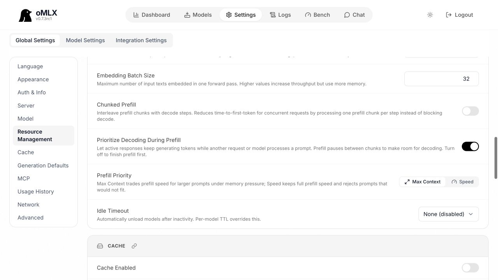
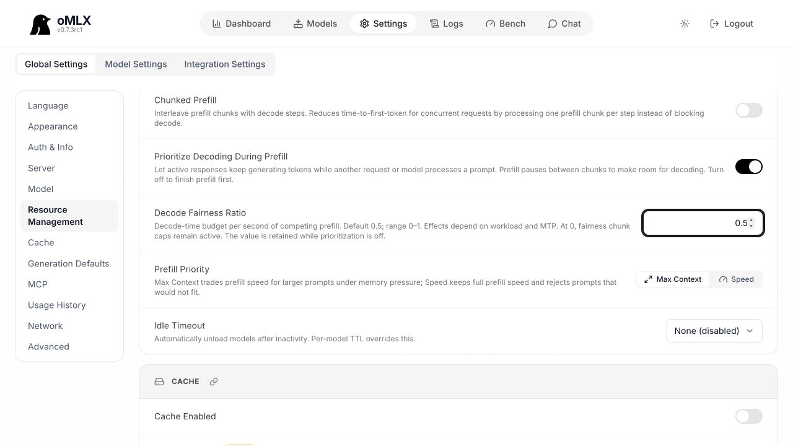
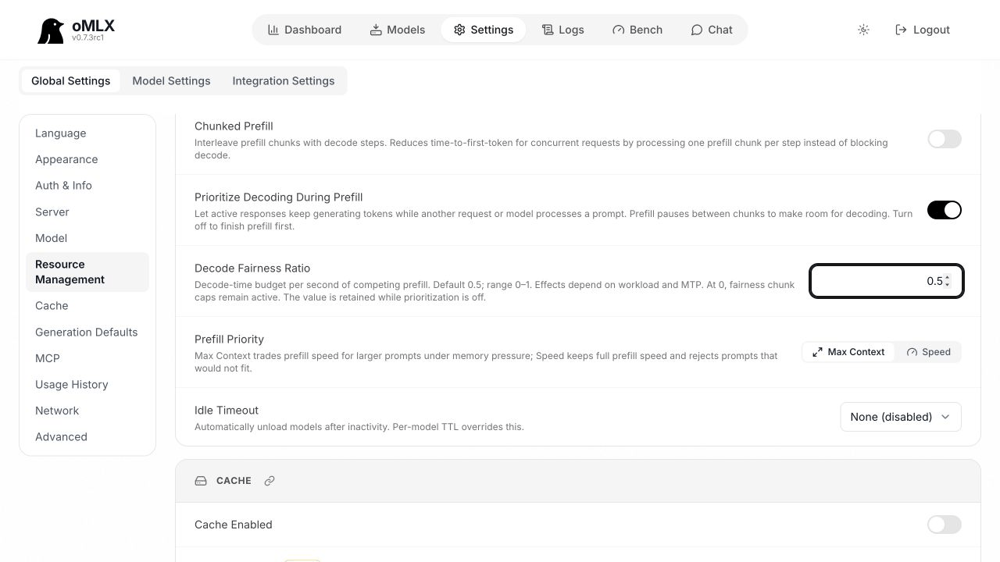

# Contribution-guide compliance update, 2026-10-27

Feature `c9a7632cca06a7af660c7f6197deb8aebfbf5f6e`, based on refreshed
upstream `e2396c765d274785ce23abb764dc7eaf6b13db11` (0.7.3rc1). The clean
rebase preserves all five feature/style patches unchanged; see `range-diff.txt`.
The full historical ratio sweep remains frozen and separate from these checks.

## Source and validation

- Corrected the new Black logging layout and Ruff test-import separation. No additional Ruff diagnostics or Black edits overlap the feature diff; existing unrelated formatting debt is retained.
- **670 focused tests passed**, including WebUI resource behavior.
- **18,404 tests passed, 1,190 skipped, zero failures** using the repository's full CI selection and ordering on Python 3.12.0: `python -m pytest tests/ apps/omlx-web/tests apps/omlx-mac/Tests/python -m "not slow and not integration" -n 3 --dist loadgroup --no-loadscope-reorder`.
- **24 native DTO/view-model tests passed**. Six standalone JavaScript test files passed.
- **`make app` and `make web` passed**. The app build uses the existing isolated Python 3.11 build environment and compiles its native kernels.
- The older full-suite DeepSeek failure did not recur in this run with current source and the CI selection/order. This is a current passing run, not proof of a root-cause fix for that historical failure.
- Remote CI is distinct and has not run: no new upstream PR has been opened.

## Current-source 27B integration

The untouched main and feature use the same local mixed 4/8-bit
`Youssofal/Qwen3.8-27B-MTPLX-Optimized-Speed` checkpoint, corpus and sampling.
Model-file hashes, corpus hash and output references also match the earlier quick
checks. The unmodified portable harness supplies every request and server arm;
the small included orchestration script changes only the measurement order.

At `0.5`, source blocks run **main → feature → feature → main** (ABBA), with
AR/MTP and contention-case order reversed in the second pass. Each source has
two trials per decoding mode. A separate feature `0.1` AR/MTP smoke follows and
is not pooled with the default comparison. In total: **10 fresh servers,
70 timed responses and 50 warmups**. Every response passes expected continuation,
exact input/output work and text/count reference checks; actual MTP activation
and effective ratio match every arm. All owned servers stopped. No guard aborts
or swap growth occurred.

Same numerical inference packages: MLX 0.32.4, mlx-lm `0d4d3d04`, mlx-vlm
0.7.10 (`4319ef2c`), Transformers 5.20.2. Both imported sources identify as
0.7.3rc1 through identical tracked version modules and every server startup
banner. The app build left ignored `omlx.egg-info` metadata in the feature checkout
reporting 0.7.3.dev2, while the baseline distribution label reads 0.7.3rc1.
The raw labels are retained and qualified in `hardware-validation.json`; they
must not be described as identical distribution metadata. Source paths/commits
and numerical package versions establish the executed code and runtime.

The benchmark interpreter is Python 3.12. Project-specific C++ extensions were
unavailable under that interpreter on both sources; both retain the default oMLX MLX/JIT execution
paths, including the registered SDPA256, GDN prefill, verify-width and ragged
decode patches. Startup registration messages are not exclusive per-call
GPU timing. This is separate from the successful Python 3.11 native app/kernel build.
These checks establish integration and record short observed timings, without
claiming best-case kernel performance or comparability with the historical full
sweep.

Workloads: warmup serial + four concurrent `256/32` responses; solo `512/16`;
four-request burst `512/16`; overlap `512/128` plus `2048/16`, newcomer one second
after first visible content. Greedy, context 32768, concurrency cap four, prefix
cache/DFlash off and stock adaptive MTP. Visible event gaps are chunk-level
observations rather than native per-token or population-tail measurements.

Minimum available memory: main **11.16 GiB**, feature **10.56 GiB**. Maximum per-arm swap growth: **0 GiB**.

### Descriptive default comparison

Medians of two trials. Overlap TTFT averages its two requests. Short trials do
not establish a default-value speedup or a regression budget: MTP was slower in
these observations, while AR burst was faster. Retain both directions rather
than treating integration checks as a new engine or tuning ranking.

| Mode / case | Main TTFT (s) | Feature TTFT (s) | Main whole case (s) | Feature whole case (s) | Main output tok/s | Feature output tok/s |
| --- | ---: | ---: | ---: | ---: | ---: | ---: |
| AR / solo | 2.84 | 2.82 | 3.73 | 3.72 | 4.34 | 4.31 |
| AR / burst | 9.31 | 8.90 | 14.91 | 14.33 | 4.29 | 4.48 |
| AR / overlap | 10.14 | 10.25 | 22.37 | 22.67 | 6.46 | 6.36 |
| MTP / solo | 2.79 | 2.96 | 3.11 | 3.28 | 5.20 | 4.88 |
| MTP / burst | 8.80 | 9.11 | 12.95 | 13.34 | 4.98 | 4.81 |
| MTP / overlap | 7.14 | 7.68 | 15.63 | 16.65 | 9.29 | 8.66 |

### Reproduce

The unchanged portable script is `scripts/benchmark_decode_fair_share.py` in the
feature checkout. To recreate this ABBA integration protocol using its helpers:

```sh
/path/to/native-mlx-env/bin/python run_refreshed_integration.py \
  --feature-root /path/to/feature-checkout \
  --baseline-root /path/to/untouched-main-checkout \
  --model-path /path/to/local-model \
  --output-dir /path/to/new-results
```

Use the exact source commits and inference dependency pins above when reproducing
these measurements. For full tuning workloads, use the portable script directly
with its documented ratios, two repeats and `solo burst overlap natural` cases.
Raw SSE and authenticated state stay local; the synthetic corpus, references,
results, CSV, provenance and validation summaries are included here.

## Actual UI captures and interaction

The refreshed WebUI before capture uses untouched `e2396c76`; the after and disabled
captures use feature `c9a7632c`. Both are light-theme captures. The original native
before/after screenshots remain in the sibling `screenshots/` directory; the
native view patch is preserved by the rebase and its DTO/view-model tests were
rerun on current source.







The animation consists of actual CUA browser captures at each interaction, with
idle holds capped for a short walkthrough: default `0.5`, edit `0.25`, disable
fairness, save, reload, and retained disabled `0.25`. No synthetic UI frames are
used. `ui-interaction.json` describes capture provenance. Test settings and empty
model directories are isolated from normal serving state.

Publication logs normalize local paths, ANSI color escapes and trailing whitespace. Original logs and the local archive validator remain local.
