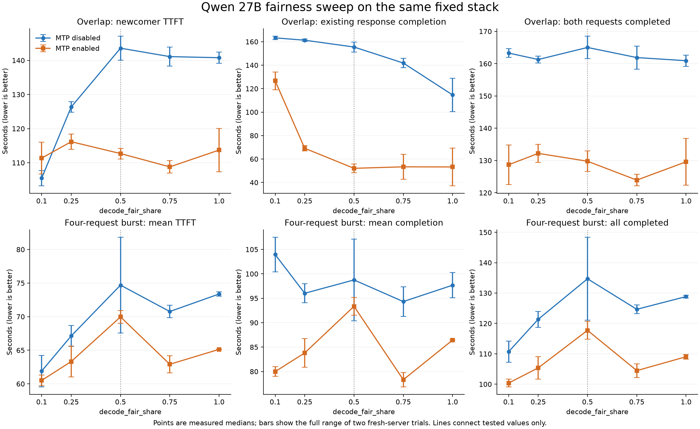
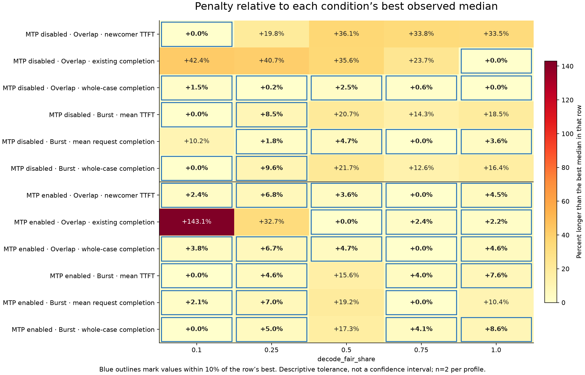

> Publication copy: local paths are redacted. Raw logs, environments and the source archive remain local. Published measurements and qualifications are unchanged.

# Matched AR/MTP decode_fair_share sweep

**No tested ratio stayed within 10% of the best observed median across all 12 mode/workload/metric combinations. Opposing material changes in both passes also occurred. This supports exposing an advanced preference, with 0.5 retained as the compatibility default.**

This is a finite, local experiment. It does not prove that no real-valued ratio could be optimal for all possible workloads. The claim is limited to the tested five values, two modes, two structured contention patterns and three latency objectives per pattern. There is no arbitrary weighted score or global-default change.

Unlike the earlier comparison, AR and native MTP use exactly the same source, dependency pins, model, API, sampling and cache settings. Earlier timings are not pooled.

All 20 fresh-server arms completed: 220 timed responses and 100 warmups. All 140 structured responses passed expected continuation, exact input/output work and full reference-text hashes. 53/80 natural responses matched the first AR/default text and work exactly. Divergent natural cells are performance-only; they do not enter the common-winner decision.

The AR/default reference’s own repeat matched 4/4 natural responses exactly. The reference was stable in its own repeat. Divergent candidate/mode answers remain ungraded. No semantic-quality equivalence is inferred from divergent-answer timings.

Figures are medians [minimum, maximum] of two fresh-server trials per profile. Ranges are not confidence intervals. Requests in a case are correlated.

One concrete endpoint comparison is AR overlap at 0.1 versus 1.0. Raising the ratio changed newcomer TTFT by +33.5% in the medians (+34.8% / +32.2% by pass), and existing-response client completion by -29.8% (-38.0% / -21.7%). Whole-case completion changed -1.4%. The full grid below checks whether a middle value offers a common near-best compromise.

For the matched MTP endpoint comparison, newcomer TTFT changed +2.1% (-7.4% / +12.5% by pass), existing completion changed -57.9%, and whole-case completion changed +0.7%. This distinguishes a substantial existing-stream effect from small or inconsistent changes in prompt/whole-case latency; it does not establish a unique MTP optimum.

MTP itself also shows workload dependence. Lowering 0.5 to 0.1 changed burst mean TTFT by -13.5% and whole-case completion by -14.7%, with the same direction in both passes. In overlap, it changed existing-response completion by +143.1%, while newcomer TTFT changed only -1.2% and whole-case completion -0.8%. Thus a value that helps the four-request burst can hurt ongoing-stream protection with native MTP enabled.

The broader sweep also updates the earlier [two-value MTP experiment](../decode_fair_share_fixed_20261025/REPORT.md). Its observed 0.1 TTFT/whole-time regression should not be treated as a stable general result: the current overlap comparisons show small, inconsistent differences on those axes. The current strong low-ratio cost is existing-response completion, and the burst benefit repeats. The older frozen measurements remain available; the experiments have different case history/order and timing variation, and their timings are not pooled.

## Best observed values and near-best choices

A best median is descriptive. The blue-outlined values in the figure are within 10% of that row’s best median; this is the preregistered practical tolerance, not statistical equivalence. Solo and natural cases are excluded from this decision.

| Mode | Workload | TTFT best median ratio | Completion best median ratio | Whole-case best median ratio |
| --- | --- | --- | --- | --- |
| AR | Long-prompt overlap | 0.1 | 1.0 | 1.0 |
| AR | Four-request burst | 0.1 | 0.75 | 0.1 |
| MTP | Long-prompt overlap | 0.75 | 0.5 | 0.75 |
| MTP | Four-request burst | 0.1 | 0.75 | 0.1 |

Completion means the existing response’s full client latency in overlap, and mean per-request client latency in burst. Whole-case completion measures when the case finishes, including staggered arrival.

| Scope | Ratios within 10% of every best median |
| --- | --- |
| AR | None |
| MTP | 0.75 |
| ALL | None |

For these MTP cases, 0.75 is a promising near-best compromise: it is the only tested value within the descriptive 10% tolerance on all six latency measures. This criterion excludes streaming gaps. It is not the best median on every metric, a proven continuous optimum, or sufficient evidence for a global default change. In particular, the two MTP/0.75 maximum visible gaps were 24.62/1.64 s versus 1.80/2.21 s at 0.5. That outlier and the stock finish/client lag below require a separate delivery interpretation; do not label 0.75 uniformly smoother.

There are 7 ratio pairs with opposing material directional changes somewhere in the structured conditions: median difference at least 10%, with the same sign in both same-pass comparisons. The full pairs and magnitudes are in results.json. This check does not supply a p-value or prove phase-level causation.

## AR: long-prompt overlap

One 2048-input / 768-output copy response, then a 16384-input / 128-output newcomer one second after first visible existing content.

| Ratio | Newcomer TTFT (s) | Existing completion (s) | Newcomer completion (s) | Whole case (s) | Output tok/s |
| --- | --- | --- | --- | --- | --- |
| 0.1 | 105.48 [103.23, 107.73] | 163.28 [161.93, 164.62] | 121.30 [118.61, 124.00] | 163.28 [161.94, 164.62] | 5.49 [5.44, 5.53] |
| 0.25 | 126.36 [124.81, 127.91] | 161.28 [160.20, 162.35] | 140.99 [139.50, 142.48] | 161.28 [160.20, 162.36] | 5.56 [5.52, 5.59] |
| 0.5 | 143.58 [140.09, 147.06] | 155.47 [151.29, 159.66] | 153.12 [150.36, 155.88] | 165.01 [161.55, 168.48] | 5.43 [5.32, 5.55] |
| 0.75 | 141.11 [138.32, 143.89] | 141.83 [137.88, 145.78] | 149.58 [146.50, 152.66] | 161.88 [158.30, 165.46] | 5.54 [5.42, 5.66] |
| 1.0 | 140.78 [139.11, 142.45] | 114.64 [100.42, 128.86] | 149.21 [147.51, 150.92] | 160.91 [159.18, 162.65] | 5.57 [5.51, 5.63] |

## AR: four concurrent requests

Four simultaneous 4096-input / 128-output copy requests.

| Ratio | Mean TTFT (s) | Mean request completion (s) | Whole case (s) | Output tok/s |
| --- | --- | --- | --- | --- |
| 0.1 | 61.90 [59.56, 64.24] | 103.95 [100.41, 107.49] | 110.70 [107.23, 114.18] | 4.63 [4.48, 4.77] |
| 0.25 | 67.13 [65.59, 68.68] | 96.02 [94.06, 97.99] | 121.37 [118.75, 123.99] | 4.22 [4.13, 4.31] |
| 0.5 | 74.69 [67.57, 81.81] | 98.75 [90.38, 107.12] | 134.69 [121.02, 148.36] | 3.84 [3.45, 4.23] |
| 0.75 | 70.76 [69.83, 71.70] | 94.32 [91.30, 97.34] | 124.65 [123.18, 126.12] | 4.11 [4.06, 4.16] |
| 1.0 | 73.37 [73.04, 73.70] | 97.67 [95.08, 100.27] | 128.84 [128.39, 129.29] | 3.97 [3.96, 3.99] |

## AR: visible streaming gaps during overlap

Intervals are between client content events, which can each contain multiple tokens. These are not native token intervals or population request p95 estimates.

| Ratio | Existing response p95 chunk gap (s) | Existing response maximum gap (s) |
| --- | --- | --- |
| 0.1 | 1.72 [1.66, 1.78] | 1.92 [1.88, 1.97] |
| 0.25 | 1.75 [1.74, 1.76] | 2.06 [1.99, 2.13] |
| 0.5 | 1.78 [1.76, 1.80] | 10.86 [9.73, 11.98] |
| 0.75 | 1.66 [1.64, 1.67] | 24.38 [24.33, 24.43] |
| 1.0 | 1.62 [1.58, 1.67] | 12.50 [1.68, 23.31] |

## MTP: long-prompt overlap

One 2048-input / 768-output copy response, then a 16384-input / 128-output newcomer one second after first visible existing content.

| Ratio | Newcomer TTFT (s) | Existing completion (s) | Newcomer completion (s) | Whole case (s) | Output tok/s |
| --- | --- | --- | --- | --- | --- |
| 0.1 | 111.36 [106.72, 115.99] | 126.63 [119.05, 134.21] | 116.46 [110.22, 122.70] | 128.69 [122.55, 134.82] | 6.98 [6.65, 7.31] |
| 0.25 | 116.16 [113.91, 118.42] | 69.15 [66.88, 71.43] | 119.16 [116.85, 121.47] | 132.20 [129.40, 135.01] | 6.78 [6.64, 6.92] |
| 0.5 | 112.69 [111.13, 114.24] | 52.10 [48.41, 55.79] | 116.07 [114.41, 117.72] | 129.77 [126.61, 132.93] | 6.91 [6.74, 7.08] |
| 0.75 | 108.79 [106.97, 110.60] | 53.37 [42.63, 64.11] | 111.84 [110.12, 113.57] | 123.93 [122.16, 125.70] | 7.23 [7.13, 7.33] |
| 1.0 | 113.71 [107.37, 120.05] | 53.26 [37.18, 69.34] | 116.83 [110.48, 123.19] | 129.59 [122.34, 136.84] | 6.94 [6.55, 7.32] |

## MTP: four concurrent requests

Four simultaneous 4096-input / 128-output copy requests.

| Ratio | Mean TTFT (s) | Mean request completion (s) | Whole case (s) | Output tok/s |
| --- | --- | --- | --- | --- |
| 0.1 | 60.51 [59.73, 61.29] | 79.98 [78.99, 80.97] | 100.38 [99.14, 101.62] | 5.10 [5.04, 5.16] |
| 0.25 | 63.32 [61.05, 65.60] | 83.81 [80.85, 86.76] | 105.37 [101.65, 109.09] | 4.86 [4.69, 5.04] |
| 0.5 | 69.96 [69.02, 70.90] | 93.35 [91.55, 95.15] | 117.73 [114.84, 120.62] | 4.35 [4.24, 4.46] |
| 0.75 | 62.91 [61.65, 64.17] | 78.32 [76.87, 79.77] | 104.47 [102.24, 106.71] | 4.90 [4.80, 5.01] |
| 1.0 | 65.13 [65.11, 65.16] | 86.44 [86.29, 86.59] | 109.04 [108.26, 109.83] | 4.70 [4.66, 4.73] |

## MTP: visible streaming gaps during overlap

Intervals are between client content events, which can each contain multiple tokens. These are not native token intervals or population request p95 estimates.

| Ratio | Existing response p95 chunk gap (s) | Existing response maximum gap (s) |
| --- | --- | --- |
| 0.1 | 1.97 [1.77, 2.18] | 9.08 [3.80, 14.35] |
| 0.25 | 1.79 [1.78, 1.80] | 2.04 [1.84, 2.25] |
| 0.5 | 1.66 [1.59, 1.72] | 2.00 [1.80, 2.21] |
| 0.75 | 1.56 [1.54, 1.58] | 13.13 [1.64, 24.62] |
| 1.0 | 1.60 [1.53, 1.67] | 14.60 [1.61, 27.59] |

## Interpretation and practical limits

The ratio multiplies measured contended prefill time to accrue decode debt. In a simplified continuously contended schedule, decode’s intended fraction is ratio/(1+ratio). It is a scheduling budget, not a hard GPU allocation or monotonic TTFT/throughput guarantee. Completing a decoder sooner can change chunking and batch formation; MTP adds adaptive proposals, handoffs and fallback. Stock MTP events are retained per case in results.json, without exclusive GPU-phase claims.

Client delivery can obscure backend progress. In the first MTP/0.75 overlap trial, the stock 768-token finish log appeared at 40.96 s, while client completion was 64.11 s, a 23.14 s difference. The first MTP/0.5 trial logged finish at 48.39 s and completed to the client at 48.41 s. This is an exploratory timestamp observation, consistent with delivery buffering; it does not isolate the buffering cause or establish an all-ratio backend-completion comparison. See [the retained observation](delivery-observation-first-pass.json).

The natural workload contains four engineering tasks with 1K/2K/4K/8K prompts and 128-output caps. It exercises a different speculative profile: first MTP/default stock logs recorded 308/398 learned-head acceptances, versus 266/267 in copy overlap. Acceptance alone is not a correctness check. Actual counts, text/reference differences and conditional timings are retained in TABLES.md and request-metrics.csv.

Uncontended AR solo completion medians ranged from 28.93 to 31.18 s across ratios. The ratio is expected to be inactive without contention; these differences are baseline variation, not a solo tuning benefit.

Uncontended MTP solo completion medians ranged from 24.80 to 27.08 s across ratios. The ratio is expected to be inactive without contention; these differences are baseline variation, not a solo tuning benefit.

All measured arms completed without a machine-guard abort. Minimum sampled available memory was 7.86 GiB; maximum positive swap-used growth relative to each arm’s baseline was 0.0 MiB. Existing swap and background applications remained; these counters do not prove zero paging or exclusive machine use.

One M3 Max / 64 GiB Mac, one mixed 4/8-bit Qwen3.8-27B-MTPLX checkpoint, two repetitions per profile. No claim covers all model families, machines, cache-hit workloads, arrival distributions or untested ratios. Small changes or inconsistent same-pass comparisons remain inconclusive. Power and population request tails were not established. A finer optimum or default change needs an independent follow-up.

The numerical setting remains a prototype. A supported exposure needs consistent validation/persistence, API/GUI wiring, loaded/future engine updates and shared forward-fairness behavior. Avoid labels promising lower values always improve TTFT. No feature change was added to the singleton-MTP fix PR.

## Reproduction and audit

- Source: PR 4837 head `04a5be43dc2f91ea2fa0aa26fbbe3a78147bf7c9` plus the retained numeric prototype.
- MLX 0.32.4; mlx-lm `0d4d3d04f8ab7ce4a51e7209e8615755a48ba94d`; mlx-vlm `4319ef2c837b7226b758c3dd69edda51b7079785`.
- MTP-off/on differs through the model setting, with actual path activation checked. Stock adaptive/copy/fallback behavior retained. DFlash and prefix caching off; context 32768; concurrency cap 4.
- No per-step, model-forward or native-token observation hooks. Startup config logging precedes measurement. Text/work parity is checked; no new direct native generated-ID capture is claimed.
- Final audit matched 1626 source files and all 16 checkpoint files; the frozen measurement files, versions, user/PR files and helper were checked. Benchmark processes stopped.
- [Frozen protocol](PLAN.md), [fixed run order](order.json), [reproduction](REPRODUCE.md), [full tables](TABLES.md), [machine-readable analysis](results.json), final audit (retained locally).
- [Final count/check summary](FINAL_CHECKS.json) and [archived source/patch record](source-bundle.json) retain the standalone source snapshot and checksum.
- Raw request bodies/SSE are in `wire/`; effective settings, logs, memory samples and case summaries are in `runs/`. All outcomes are retained locally.

